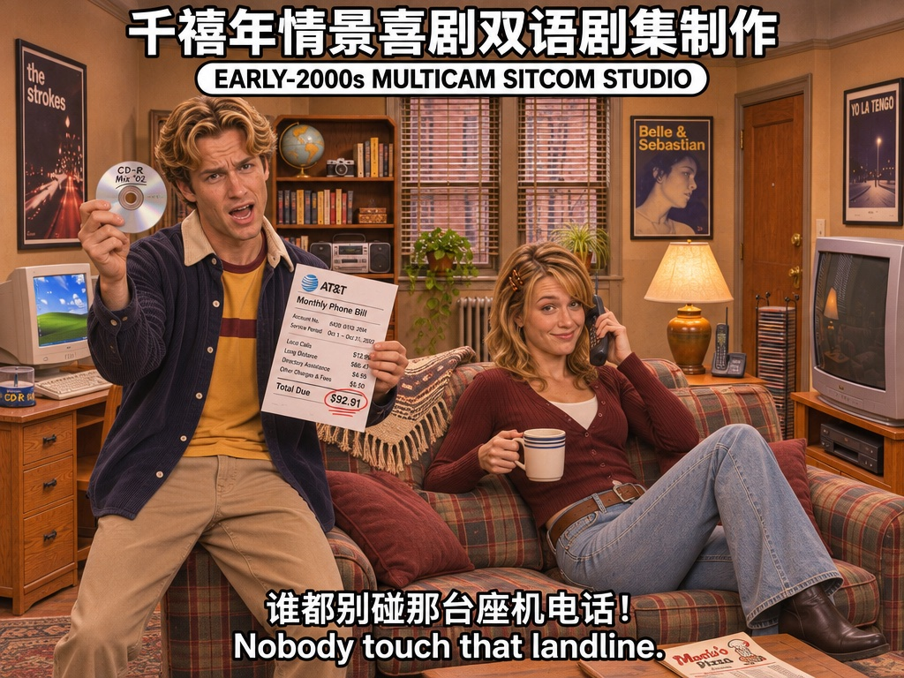
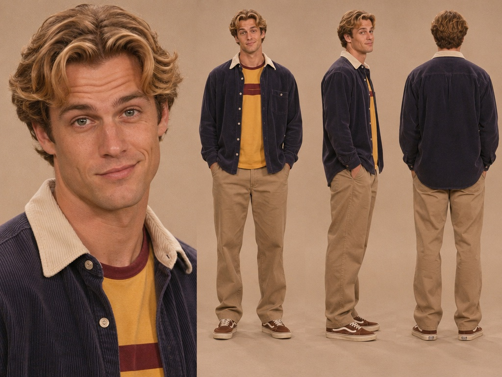
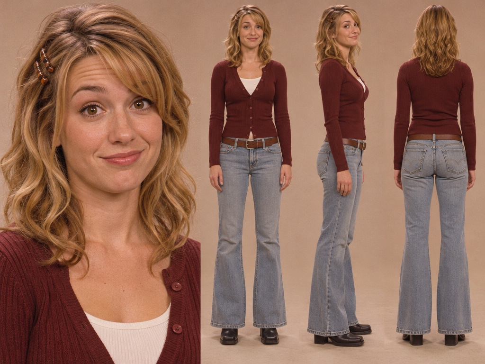
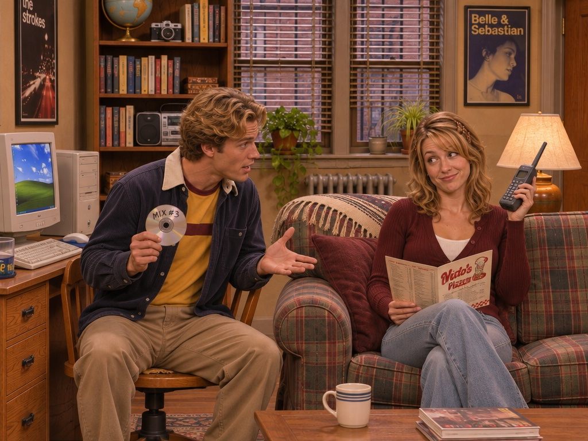
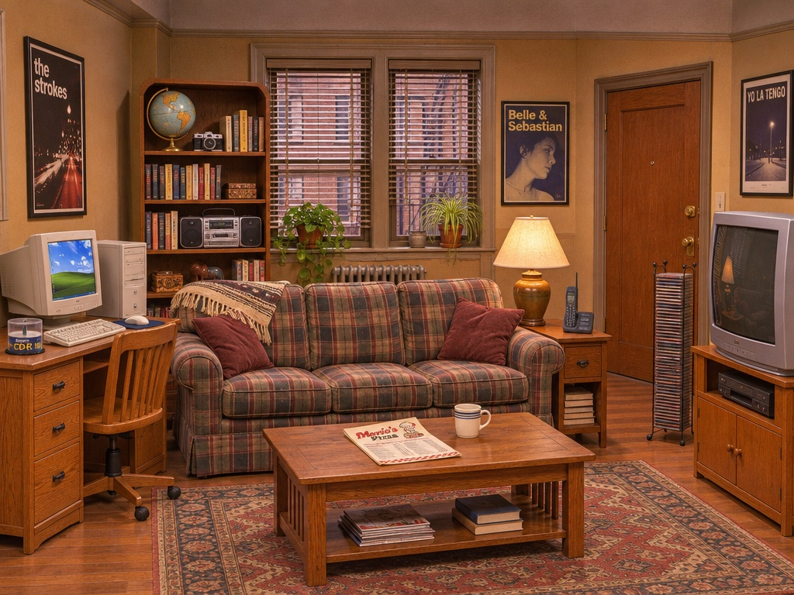
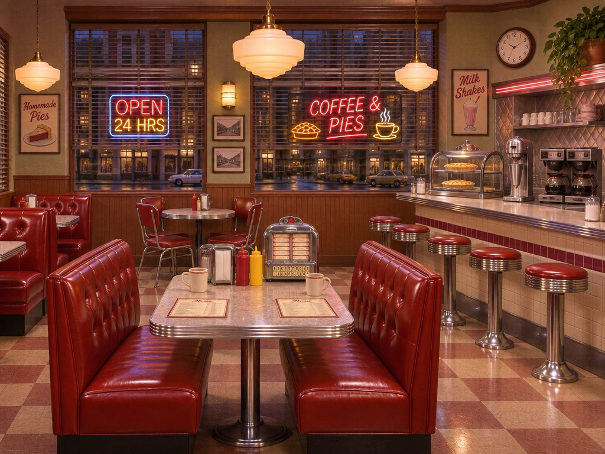
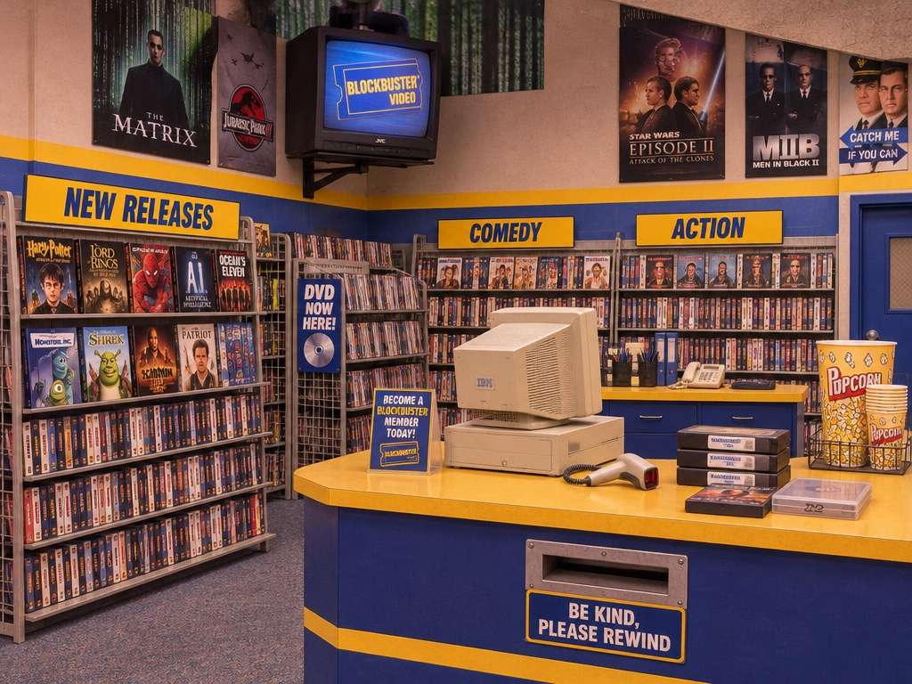
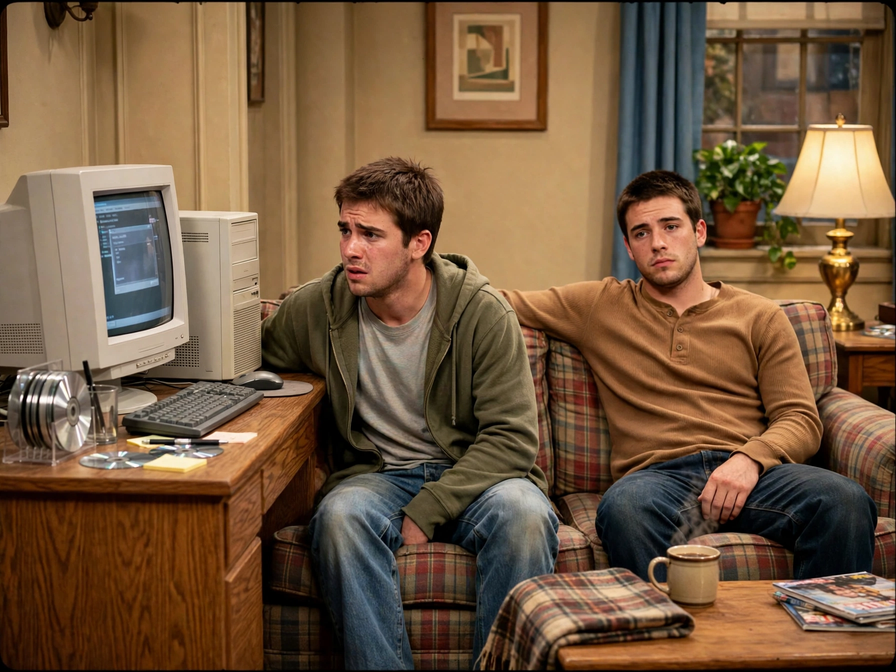
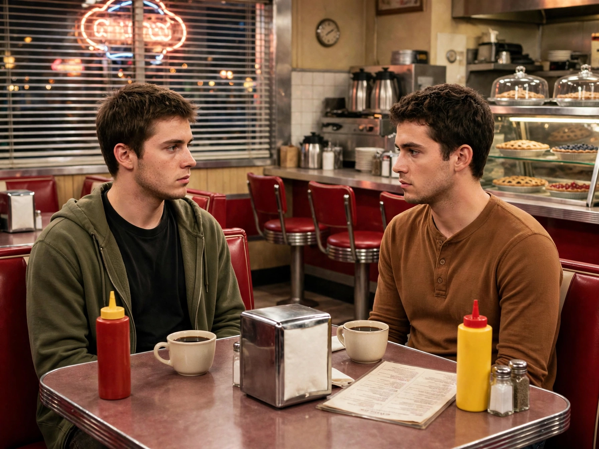

# 千禧年情景喜剧双语剧集制作 / EARLY-2000s MULTICAM SITCOM STUDIO

> 30 秒千禧年（2000–2005）美式 4:3 多机位情景喜剧端到端制作：美式英语对白、中英双语字幕、Nano Banana 2 分镜图、Seedance 2.5 视频片段、两遍字幕压制。
>
> [English](README.md)



## 功能

一次技能调用，从点子到 30.0 秒成片：

1. **剧本** — 从 5 大喜剧题材 × 6 大三面墙场景中选择（或给一句话点子），得到 5 镜双语剧本（美式英语对白 + 中文翻译），确认后继续。
2. **分镜图** — Nano Banana 2 生成 5 张 4:3 分镜首帧图，锁定 1:7.5 成人头身比；由你确认。
3. **视频** — Seedance 2.5 把 5 张图转成 5 段有声视频（6 秒 + 6 秒 + 6 秒 + 7 秒 + 5 秒），逐段核验台词准确度、时间戳、无背景音乐。
4. **成片** — 硬切拼接、响度归一、两遍字幕压制：底部中英双语对白字幕（中文在上、英文在下），开场前 2.8 秒顶部叠加中英双语剧集名片头。

全流程只有两个确认节点：**剧本**和**分镜图**。分镜图确认通过后，剩余步骤自动连续跑完，直接交付成片。

## 样图

演示卡司 — 角色设定图（面部特写 + 正/侧/背全身三视图）：

| | |
|---|---|
|  |  |
| Ryan | Chloe |

分镜帧 — 双人镜头，拨号混音 CD 情节（Ep01）：



三面墙场景空镜（可直接布景）：

| | | |
|---|---|---|
|  |  |  |
| 场景 A — 2002 年合租公寓客厅 | 场景 B — 复古快餐店卡座 | 场景 D — 音像租借店 |

### 基线主角 — Mason 与 Alex

以下生成的样图出演的是技能基线主角：**Mason**（橄榄绿卫衣）和 **Alex**（焦糖亨利衫），穿搭与规范完全一致。上方的 Ryan 与 Chloe 为演示卡司；造型基线不变。





## 快速开始

```
使用 millennium-sitcom-studio 技能制作 Ep01：
一集 30 秒千禧年情景喜剧，讲 56K 拨号下载到 99% 时断线的故事。
```

Agent 会带你走完：选题材 → 选场景 → 确认剧本 → 确认分镜图 → 交付成片。完整示例剧本见 [`examples/ep01-dial-up-disaster.md`](examples/ep01-dial-up-disaster.md)。

## 环境要求

- 支持参考图的生图模型（默认 **Nano Banana 2**；需要对比面部细节时可用 GPT Image 2.5），4:3，2048×1536。
- 支持首帧图驱动的生视频模型（默认 **Seedance 2.5**），4:3，1112×834，原生声音开启。
- ffmpeg（或同等成片合成工具），用于拼接、响度归一与硬字幕压制。
- 两位主角的参考照片（用于单人角色设定图）。

## 画面风格

2000–2005 年美式四机位棚拍情景喜剧：35mm Kodak Vision2 暖色调与细腻胶片颗粒，转 NTSC 电视播出质感；高调均匀的棚拍顶光与正面柔光，真实皮肤肌理（可见毛孔、眼下自然纹理、真实衣物织物）——无磨皮、无蜡像感、无网红滤镜。冷幽默表演，自然眨眼与呼吸。

年代真实性是硬性要求：米白 CRT 显示器、座机电话、Nokia 3310 风格直板机、VHS 录像带、CD-R 光盘桶——**绝不出现**智能手机、平板、液晶超薄屏或蓝牙耳机。

## 文件结构

```
millennium-sitcom-studio/
├── SKILL.md                  # 技能定义（frontmatter + 工作流 + 规则）
├── README.md                 # 英文版说明
├── README-CN.md              # 中文版说明
├── LICENSE
├── examples/
│   └── ep01-dial-up-disaster.md   # 完整示例剧集剧本
├── references/
│   ├── language-and-voice.md      # 默认语言与音色规范
│   ├── model-spec.md              # 模型、参数与 5 镜时长
│   ├── subtitle-spec.md           # 两遍式字幕压制规范
│   ├── aesthetics.md              # 视觉美学、造型与年代道具
│   ├── story-premises.md          # 5 大喜剧题材
│   └── sets.md                    # 6 大三面墙场景
└── samples/
    ├── cover-title-card.jpg       # 剧集标题卡（主视觉）
    ├── sample-ryan.jpg            # Ryan — 角色设定图
    ├── sample-chloe.jpg           # Chloe — 角色设定图
    ├── sample-two-shot-mix-cd.jpg # 分镜帧（Ep01 情节）
    ├── set-apartment-living-room.jpg
    ├── set-diner-booth.jpg
    ├── set-video-rental-store.jpg
    ├── sample-hero-two-shot.webp  # 备用生成样图：Mason 与 Alex 公寓双人镜头
    └── sample-diner-booth.webp    # 备用生成样图：Mason 与 Alex 快餐店双人镜头
```

## 许可证

MIT — 详见 [LICENSE](LICENSE)。
