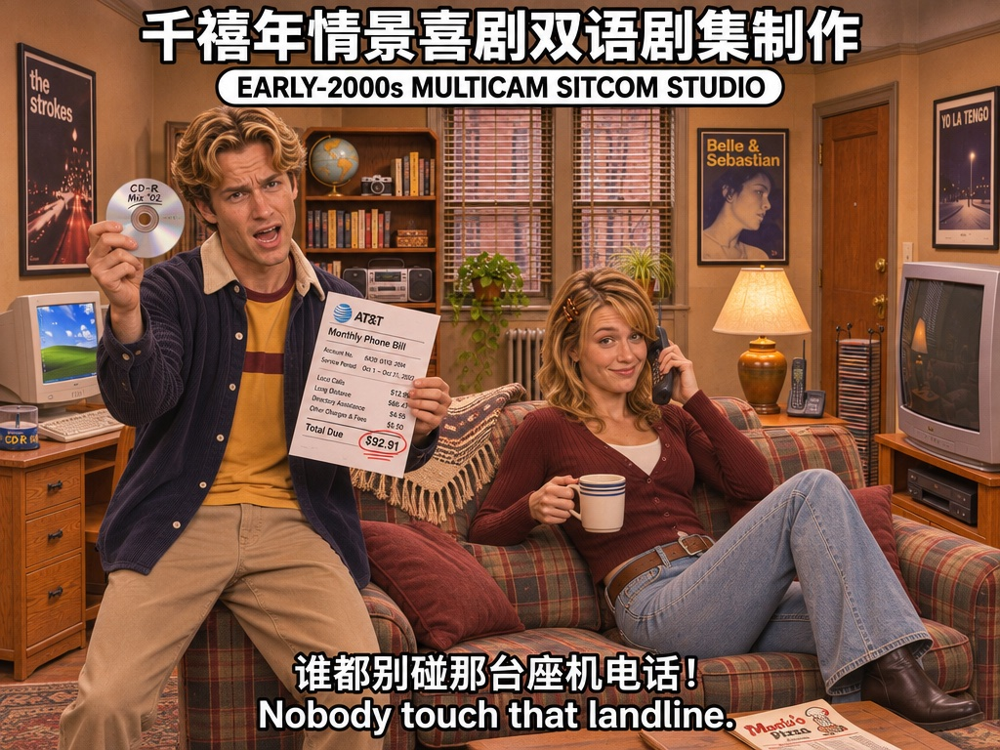
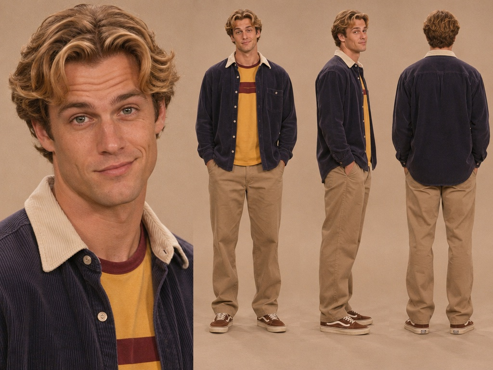
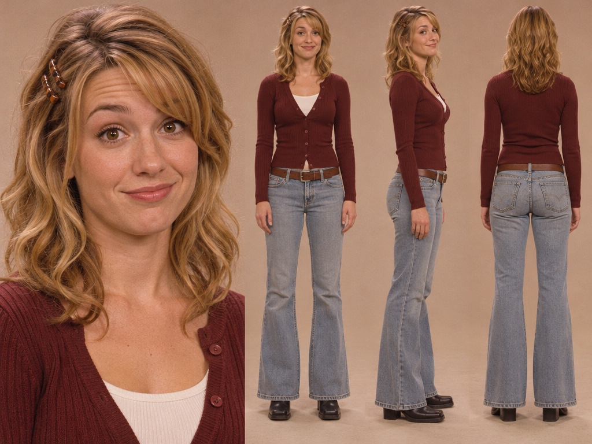
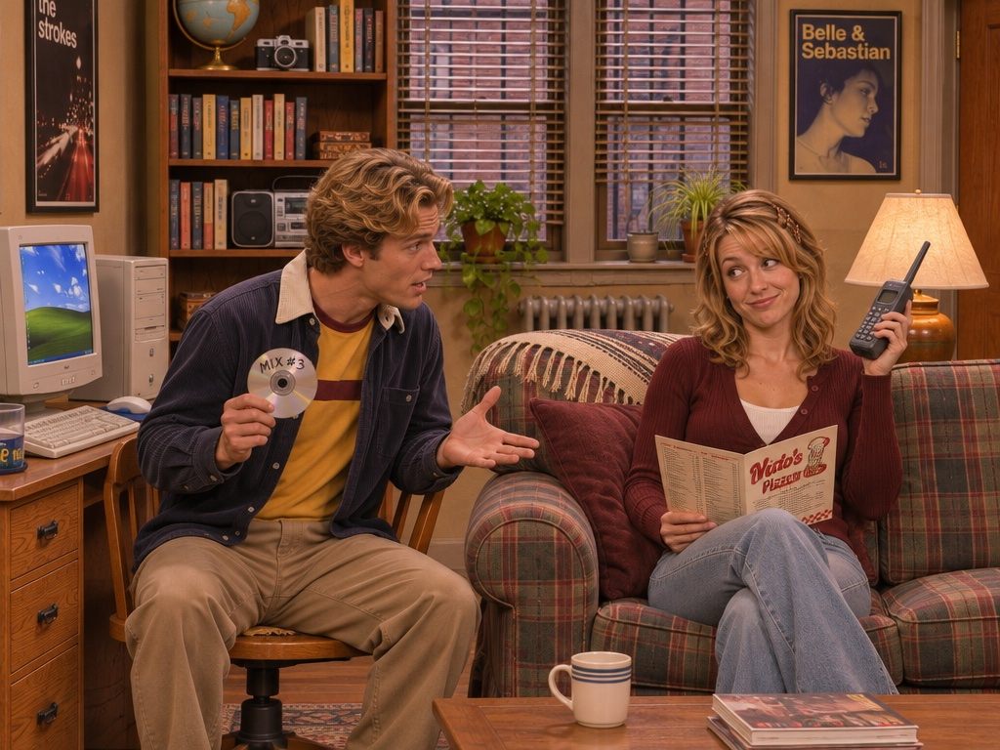
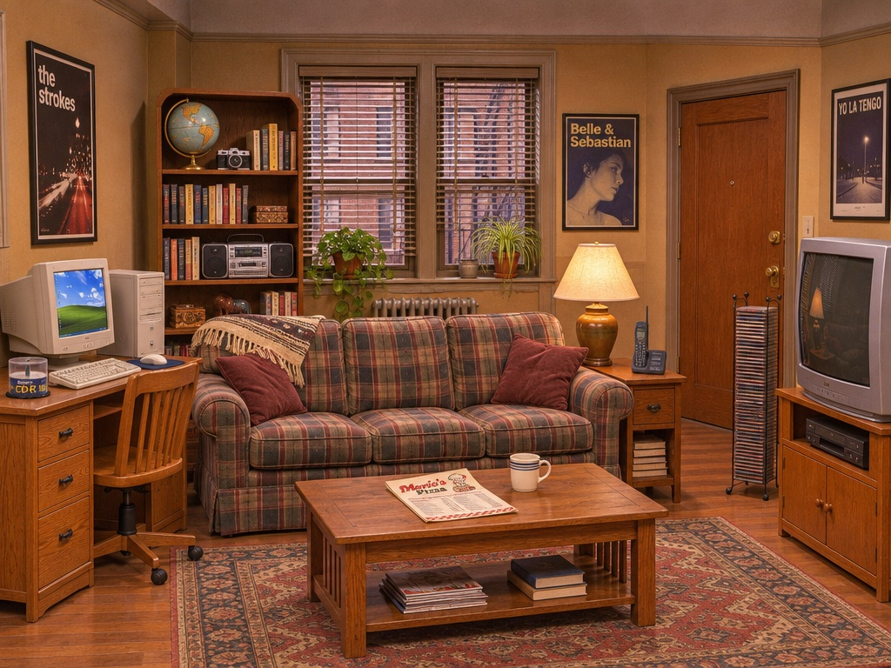
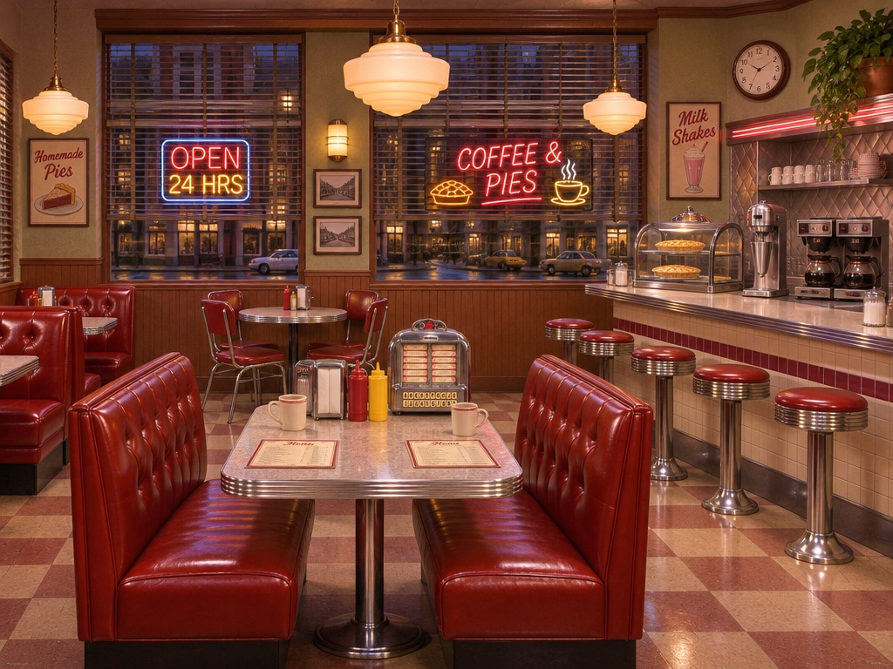
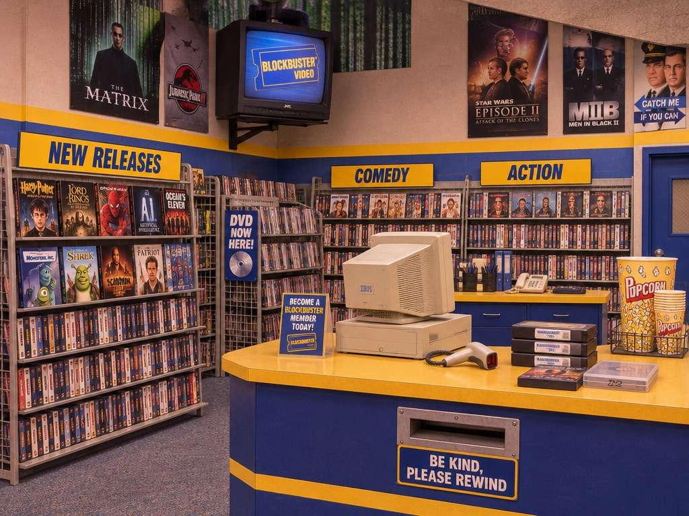
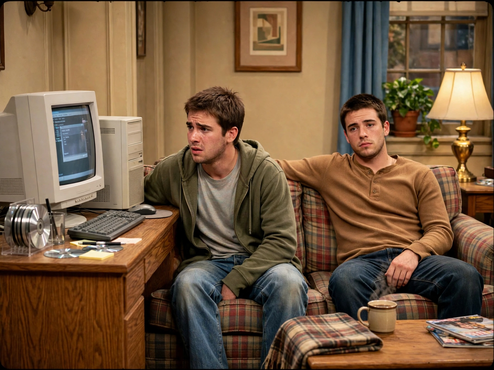
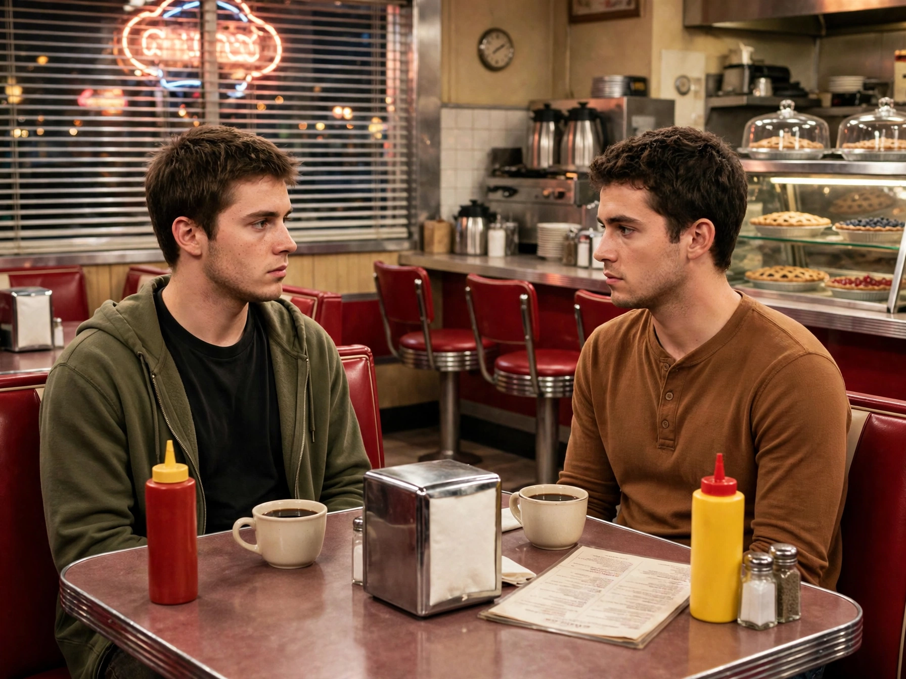
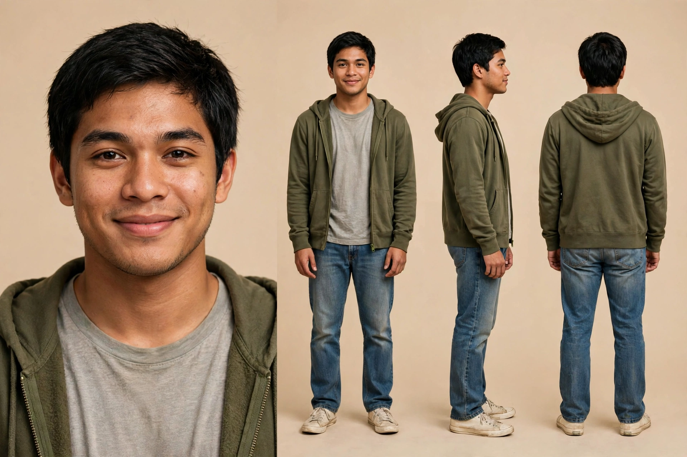

# 千禧年情景喜剧双语剧集制作 / EARLY-2000s MULTICAM SITCOM STUDIO

> End-to-end production of 30-second Y2K (2000–2005) American 4:3 multi-camera sitcom episodes — American English dialogue, Chinese/English bilingual subtitles, Nano Banana 2 storyboard frames, Seedance 2.5 clips, two-pass subtitle finishing.
>
> 千禧年情景喜剧双语剧集制作：30 秒 4:3 多机位情景喜剧端到端全自动生产。



## What it does

One skill call takes you from premise to a finished 30.0-second episode:

1. **Script** — pick from 5 comedy premise categories × 6 three-wall studio sets (or give a one-line idea), get a 5-shot bilingual script (American English dialogue + Chinese translation) and confirm it.
2. **Storyboard** — Nano Banana 2 generates 5 first-frame images in 4:3 with locked 1:7.5 adult proportions; you confirm the frames.
3. **Video** — Seedance 2.5 turns the 5 frames into 5 voiced clips (6s + 6s + 6s + 7s + 5s), each verified for line accuracy, timestamps, and zero background music.
4. **Finishing** — hard cuts, loudness normalization, and a two-pass subtitle burn: bilingual dialogue subtitles at the bottom (Chinese over English) plus a bilingual episode title card at the top for the first 2.8 seconds.

Only two approval gates in the whole pipeline: **script** and **storyboard frames**. After the frames are approved, everything runs automatically to the final episode.

## Samples

Demo leads — character reference sheets (face close-up + front/side/back full-body views):

| | |
|---|---|
|  |  |
| Ryan | Chloe |

Storyboard frame — two-shot, dial-up mix CD beat (Ep01):



Three-wall set anchors (empty sets, ready for staging):

| | | |
|---|---|---|
|  |  |  |
| Scene A — 2002 apartment living room | Scene B — retro diner booth | Scene D — video rental store |

### Baseline leads — Mason & Alex

The generated samples below feature the skill's baseline leads: **Mason** (olive-green hoodie) and **Alex** (caramel henley), in the exact wardrobe the spec defines. Ryan and Chloe above are the demo cast; the wardrobe baseline stays as specified.



| | |
|---|---|
|  |  |
| Diner booth two-shot | Mason character reference sheet |

## Quick start

```
Use the millennium-sitcom-studio skill to make Ep01:
a 30-second Y2K sitcom about a 56K dial-up download dying at 99%.
```

The agent will walk you through premise → set → script approval → storyboard approval → final episode. See [`examples/ep01-dial-up-disaster.md`](examples/ep01-dial-up-disaster.md) for a complete worked script.

## Requirements

- An image model with reference-image support (default **Nano Banana 2**; GPT Image 2.5 as an alternative for face detail), 4:3, 2048×1536.
- A video model with start-frame support (default **Seedance 2.5**), 4:3, 1112×834, native sound on.
- ffmpeg (or an equivalent finishing tool) for stitching, loudness normalization, and hard subtitle burn-in.
- Reference photos of the two leads (for the single-character reference sheets).

## The look

2000–2005 American four-camera studio sitcom: 35mm Kodak Vision2 warm tones and fine grain transferred to NTSC broadcast, flat high-key studio lighting, real skin texture (visible pores, natural under-eye texture, real fabric) — no beauty filters, no wax-skin, no influencer look. Deadpan delivery, natural blinks and breathing.

Period authenticity is enforced: beige CRT monitors, cordless landlines, Nokia 3310-style phones, VHS tapes, CD-R spindles — and **no** smartphones, tablets, flat screens, or Bluetooth earbuds, ever.

## File structure

```
millennium-sitcom-studio/
├── SKILL.md                  # Skill definition (frontmatter + workflow + rules)
├── README.md
├── LICENSE
├── examples/
│   └── ep01-dial-up-disaster.md   # Complete worked episode script
├── references/
│   ├── language-and-voice.md      # Default language & voice spec
│   ├── model-spec.md              # Models, params, 5-shot timing
│   ├── subtitle-spec.md           # Two-pass subtitle finishing
│   ├── aesthetics.md              # Look, wardrobe, period props
│   ├── story-premises.md          # 5 premise categories
│   └── sets.md                    # 6 three-wall studio sets
└── samples/
    ├── cover-title-card.jpg       # Episode title card (hero)
    ├── sample-ryan.jpg            # Ryan — character reference sheet
    ├── sample-chloe.jpg           # Chloe — character reference sheet
    ├── sample-two-shot-mix-cd.jpg # Storyboard frame (Ep01 beat)
    ├── set-apartment-living-room.jpg
    ├── set-diner-booth.jpg
    ├── set-video-rental-store.jpg
    ├── sample-hero-two-shot.webp  # Extra generated sample: Mason & Alex, apartment two-shot
    ├── sample-character-sheet.webp # Extra generated sample: Mason character sheet
    └── sample-diner-booth.webp    # Extra generated sample: Mason & Alex, diner two-shot
```

## License

MIT — see [LICENSE](LICENSE).
